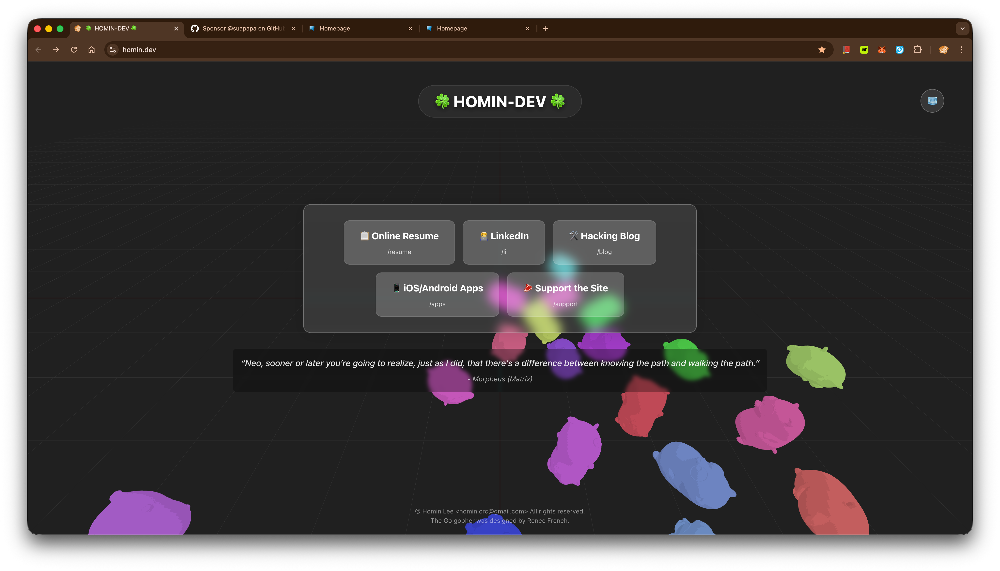

# Ingress site of Homin.dev

Live > [HERE](https://homin.dev) <

## Notes

- **3D gopher**: Mesh is `asset/go_gopher_low_0.02.stl`, loaded in the browser with Three.js `STLLoader` at `/model/go_gopher_low_0.02.stl` (Vite `public/model/go_gopher_low_0.02.stl` is a symlink to that file in dev).
- **UI**: Dark typographic chrome over the WebGL scene (Bricolage Grotesque, Go cyan accent). Design tokens live in `DESIGN.md` / `frontend/src/style.css`.
- **Dev**: `npm run dev` in `frontend/`, `go run .` for the API. Production: `npm run build` then run the Go server.
- **Gophers only**: `?show_gophers_only=true` hides the link overlay.
- **Crawlers / SSR**: SPA 라우트는 백엔드가 서버 렌더링합니다 — JS 를 실행하지 않는 크롤러(특히 네이버 Yeti)는 빈 `#app` 만 보기 때문입니다. 구조·검증법·주의사항은 `AGENTS.md` 참고.